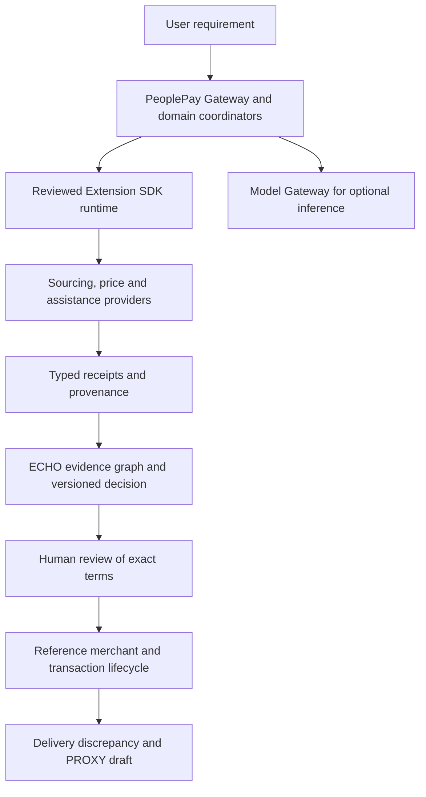

# PeoplePay 360

**An evidence-aware transaction operating system for AI agents.**

PeoplePay connects a user's requirement to specialist research, traceable evidence,
a versioned decision, human review, a transaction record, and after-sales support.
The aim is to keep the reasoning behind an action available throughout its
lifecycle: what was requested, which sources informed the recommendation, what
was approved, and what happened afterward.

The repository brings together a Python Gateway, ECHO's evidence graph, a shared
extension contract, a provider-agnostic Model Gateway, HYPERGRID computation
experiments, and independently runnable specialist applications. They have
explicit handoff boundaries and different levels of integration. They do not yet
share one runtime, one database, or one sign-in system.

**Current evidence baseline: October 22, 2026.** The audit includes the October 15
platform and payment additions at
[`7b312713`](https://github.com/victrvondoom/Peoplepay-360/commit/7b31271379839364cfe3fcf0f1c7d4982dee6b80).
Read the [26-claim evidence table](docs/evidence/CLAIMS.md) for exact boundaries.
Reference commerce moves no money. Model adapters are mock/contract tested;
no model provider is live-certified by this audit. HYPERGRID model prices,
latencies, and accuracy are simulated assumptions. Production deployment and
complete platform centralization remain unverified.

## Contents

- [What PeoplePay does](#what-peoplepay-does)
- [Architecture and ownership](#architecture-and-ownership)
- [Core systems](#core-systems)
- [Specialist applications](#specialist-applications)
- [Platform service modules](#platform-service-modules)
- [End-to-end workflows](#end-to-end-workflows)
- [Verification and benchmark evidence](#verification-and-benchmark-evidence)
- [Run the offline evidence demo](#run-the-offline-evidence-demo)
- [Run the local Gateway and ECHO](#run-the-local-gateway-and-echo)
- [Enable CivicMesh assistance](#enable-civicmesh-assistance)
- [Connect models and specialist services](#connect-models-and-specialist-services)
- [Interface and API map](#interface-and-api-map)
- [Data, persistence, and security](#data-persistence-and-security)
- [Testing and development](#testing-and-development)
- [Troubleshooting](#troubleshooting)
- [Repository map](#repository-map)
- [Current limitations and next steps](#current-limitations-and-next-steps)
- [Documentation and licensing](#documentation-and-licensing)

## What PeoplePay does

A useful transaction assistant needs more than a recommendation. It needs to
preserve constraints, distinguish observations from estimates, obtain approval for
the exact action, and retain enough context to handle an exception later.
PeoplePay organizes those responsibilities around a transaction or workflow.

| Need | PeoplePay mechanism | Present boundary |
|---|---|---|
| Preserve the request | Original utterance, structured requirement, budget, currency, and constraints | User input is retained as input; it is not independently verified evidence |
| Gather specialist intelligence | Reviewed adapters and Extension SDK receipts | Only configured providers can supply native results; reference modes are explicitly selected |
| Understand why a claim should be trusted | ECHO source lineage, correlation checks, temporal context, and decision versions | A traceable claim can still be wrong or unsupported |
| Explain a recommendation | Preserved decision snapshot and optional model-generated explanation | An explanation does not grant authority to transact |
| Review the exact terms | Version- and scope-bound approval in the relevant workflow | Generic workflow execution callbacks are not connected by default |
| Track an order lifecycle | Gateway records and a persistent reference merchant | Reference orders are simulated and never settle money |
| Handle a short delivery | Approved evidence packet and PROXY dispute draft | The draft is not submitted automatically |
| Avoid unnecessary computation | HYPERGRID dependency tracking, caching, and selective re-explanation | A separate offline computation slice; no HYPERGRID-to-ECHO persistence seam yet |

The most complete reference commerce scenario orders **300 office chairs**, records
**260 delivered**, and prepares a draft for the **40-chair shortfall**. A separate
assistance workflow routes U.S. needs through CivicMesh's local deterministic
policy engine. Room design, property analysis, and operations assurance retain
specialist workspaces and their own authority.

## Architecture and ownership

The product shell coordinates a journey while each service remains responsible
for its own records. Extension receipts are proposals; ECHO evaluates evidence;
the Gateway mediates approved transaction actions. External merchants and payment
processors remain authoritative for actual orders and settlement.



This diagram describes the reference/domain workflow. It does not mean every
specialist is registered with the generic engine, that HYPERGRID is connected to
ECHO, or that a production merchant/payment connector exists.

| Responsibility | Authority | Other systems receive |
|---|---|---|
| Original requirement and transaction lifecycle | PeoplePay Gateway and transaction layer | Scoped context and correlated references |
| Provider-specific research and native state | The relevant specialist | Typed results, source references, estimates, and uncertainty |
| Canonical evidence lineage and historical reasoning | ECHO / FalkorDB | Decision identity, version, hash, and evidence trace |
| Exact approval and controlled action handoff | Relevant PeoplePay workflow and Gateway boundary | An approval bound to the reviewed decision and terms |
| Reference catalog, checkout, and order events | Reference merchant in the sandbox journey | Persistent reference order/session identifiers |
| Real inventory, fulfillment, and payment settlement | External merchant / payment processor | Verified external references when a future connector is implemented |
| Dispute case and draft | PROXY or the explicitly labelled reference adapter | An evidence packet and draft status |
| Operational incidents and remediation | Beacon | Separate operator-controlled assurance records |

See the [source-of-truth matrix](docs/architecture/SOURCE_OF_TRUTH_MATRIX.md)
and [journey ownership guide](docs/architecture/UNIFIED_JOURNEYS.md).

## Core systems

### 1. PeoplePay Gateway and transaction layer

**Source:** [gateway/](gateway/), [transaction/](transaction/), and
[Beacon's PeoplePay foundation](Beacon-main/src/beacon/peoplepay/).

The Gateway serves the main browser workspace and HTTP APIs. It accepts a user's
requirement, maintains transaction context, invokes configured capabilities, and
exposes plans, evidence, timelines, carts, reference orders, delivery updates,
and dispute drafts. Transaction records persist in SQLite.

The transaction foundation preserves the original utterance and separates intent,
policy, evidence, plans, and lifecycle state. Money-facing API fields use integer
minor units: INR 1,000 is `100000`. A validated plan is not payment authorization;
a sandbox order is not proof that a merchant accepted an order.

The root `transaction/aggregate.py` reuses the existing
`beacon.peoplepay.transaction.Transaction` foundation. Contributors should avoid
creating a competing aggregate or a second source of transaction authority.

**Current boundary:** the local workspace and reference lifecycle exist. Live
checkout is unavailable. The newer `payment/` HTTP surface has known routing and
ownership gaps and is excluded from the recommended external demo.

### 2. ECHO: evidence correlation and decision audit

**Source:** [echo/](echo/) · [Architecture](docs/echo-architecture.md).

ECHO is the canonical trust and provenance service. It records sources, claims,
evidence, entities, relationships, extension runs, decisions, approval references,
and transaction references in FalkorDB. It retains how a recommendation was reached
instead of keeping only the final score.

ECHO evaluates identity aliases, timing, contradictions, and source dependencies.
Repeated claims from one root should not look like several independent witnesses.
A decision snapshot preserves the provider receipts, normalized results,
alternatives, warnings, policy, and decision hash available at review time.

Its synthetic false-consensus demonstration gives Supplier Alpha a raw score of
94 from observations tracing to one source root. Supplier Beta starts at 87 but
has three provenance roots. The robust scores become 71 and 85 respectively,
changing the recommendation to Beta. These are invented demonstration values,
not supplier facts or validated procurement advice.

**Current boundary:** ECHO is a separate FastAPI service with a graph dependency.
Its standalone synthetic decisions are barred from approval. The explicitly
labelled reference procurement journey has its own controlled approval path.
HYPERGRID does not currently read or write ECHO.

### 3. Extension SDK and reviewed capability runtime

**Source:** [packages/peoplepay-extension-sdk/](packages/peoplepay-extension-sdk/),
[journey/extension_runtime.py](journey/extension_runtime.py), and
[extensions/](extensions/).

The SDK provides validated contracts for provider metadata, capabilities, context,
requests, results, entities, evidence, action proposals, health, and correlated
events. A provider implements `metadata()`, `capabilities()`, `health()`, and
asynchronous `execute()`.

The host runtime adds manifest-based capability resolution, jurisdiction checks,
enabled/disabled state, scoped input fields, deadlines, concurrency bounds,
producer/version validation, sanitized failures, and host-generated provenance.
Fallback attempts retain separate receipts. Independent work can run concurrently.
Procurement and assistance share this invocation layer.

Stable capability IDs describe the requested work, such as `supplier.discovery`,
`price.observe`, or `policy.eligibility`. A reviewed manifest maps them to the
provider's own capability names. Manifests are configuration; strings do not
execute imports or install arbitrary code.

**Current boundary:** contract permissions are not an operating-system sandbox.
Local Python adapters must be reviewed trusted code. PROXY, Rumi, InHeir, and
Beacon are not all complete generic SDK providers. A new canonical evidence
domain still requires a reviewed ECHO translator and policy.

[Runtime architecture and provider onboarding](docs/architecture/EXTENSION_RUNTIME.md).

### 4. Reusable workflow engine

**Source:** [journey/workflow.py](journey/workflow.py) ·
[Workflow documentation](docs/architecture/WORKFLOW_ENGINE.md).

The reusable engine coordinates required, optional, and enrichment capability
steps. It stores owner-scoped snapshots and versioned events, supports requests
for more information, and preserves earlier decision versions when inputs change.

Approvals bind decision identity, version, and a hash of the exact action scope.
Changed input invalidates the previous approval. Event IDs support replay checks;
reusing an ID for a different payload is rejected. Execution callbacks must still
validate authority and provide their own durable external idempotency.

States cover creation, discovery, missing information, evaluation, review,
approval, authorization, execution, completion, partial results, failure, and
cancellation. Missing evaluation produces `REVIEW_REQUIRED`, never authorization.

**Current boundary:** the generic HTTP engine has no ECHO evaluator or Gateway
executor attached by default. Procurement and assistance retain domain-specific
coordinators and stores. Process-local locks and SQLite revision checks do not
establish distributed exactly-once execution.

### 5. Model Gateway: provider-agnostic inference

**Source:** [packages/peoplepay-model-gateway/](packages/peoplepay-model-gateway/) ·
[Model documentation](docs/models/README.md).

The Model Gateway separates a conversation from the provider used to serve it.
It normalizes messages, model discovery, capabilities, selection, inference,
streaming, fallback, health, usage, and credential handling. The same model can
have several provider routes with different privacy, pricing, and availability.

Users can choose an exact route or an automatic policy. Selection considers
required capabilities, availability, privacy, context fit, preferences, and known
usage information. Capabilities carry evidence: provider metadata, a capability
test, a user override, or a weaker inferred fallback. Unknown price is not a
claim that inference is free.

| Provider family | Adapter boundary in this repository |
|---|---|
| OpenAI, Anthropic, OpenRouter | Contract and mock verification |
| Amazon Bedrock | Contract/mock verification using a fake client |
| NVIDIA NIM and OpenAI-compatible endpoints | Contract and mock verification |
| Ollama | Contract/mock verification, including stub-server HTTP tests |
| JEV and Laya typed decision providers | Mock only; wire protocol remains unverified |

Canonical conversation history keeps who served each response. Switching models
must surface unsupported image/file context rather than silently discard it.
Fallback is bounded and must respect the selected privacy mode. Strict pinned
selection can refuse rerouting; local-only work must not fall back to the cloud.

Persisted credentials use an encrypted vault when configured, and public outputs
mask or omit secrets. Inference provenance remains distinct from source evidence.
A model can draft or explain; it cannot approve a payment, order, or submission.

**Current boundary:** no provider is live-certified by this audit. Stub HTTP and
fake transport tests do not prove that a real account can access a named model.
See [provider status](docs/models/PROVIDERS.md), [privacy](docs/models/PRIVACY.md),
and [fallback behavior](docs/models/FALLBACKS.md).

### 6. HYPERGRID: incremental computation and explanation routing

**Source:** [packages/peoplepay-hypergrid/](packages/peoplepay-hypergrid/) ·
[Explicit implementation status](docs/hypergrid/STATUS.md).

HYPERGRID experiments with doing less work when evidence changes. Its
knowledge-time store supports pinned snapshots; the incremental engine records
which observations each decision actually read. A revision identifies candidate
decisions through that dependency index. Only changed fingerprints require
recomputation, and only changed recommendation summaries require re-explanation.

The package includes a bounded single-machine worker grid with backpressure,
retries, dead-letter handling, and cancellation. Its routing experiments combine
deterministic explanations for easy decisions, compact prompts, an exact-match
cache, privacy-aware route selection, validation, escalation, and a deterministic
last resort. A Model Gateway backend exists, verified with mock providers.

The correctness check compares incremental results with full recomputation at the
same knowledge time. Random revision sequences and an intentional invalidation
mutation test exercise this boundary. Cross-process tests check stable
fingerprints and spawned workers.

**Current boundary:** the worker grid is not a distributed cluster. Three World
Bank annual series are historical snapshots; category series and procurement
requirements are synthetic. Revisions to real series are injected experiments.
There is no live market feed, out-of-sample forecast evaluation, semantic cache,
serving-stack prefix cache, or HYPERGRID-to-ECHO integration. Model prices,
latencies, and accuracy are simulated assumptions, not real LLM measurements.

The implementation applies established incremental-computation ideas to this
evidence workload. The repository documents [prior art](docs/hypergrid/PRIOR_ART.md);
it does not establish scientific priority or a new model architecture.

### 7. Centralized offline evidence workflow

**Source:** [scripts/demo_evidence.py](scripts/demo_evidence.py) and
[docs/evidence/](docs/evidence/).

This command is the smallest reproducible entrypoint for an external technical
demo. It validates the canonical claim manifest, runs named offline test suites,
executes an 80-decision revision-aware routing scenario, and writes a receipt
containing source hashes, test counts, revision impact, and exactness results.

The scenario injects one evidence revision, recomputes affected decisions, and
re-explains changed summaries. It reports both validator acceptance and correctness
against synthetic known truth. These are deliberately separate: an accepted
explanation may contain an unsupported claim.

The receipt fails its offline checks if tests fail, the demo errors, or source
content changes during execution. It never promotes a mock result to live
verification. `--check` validates manifest/table consistency only.

**Current boundary:** this centralizes evidence inspection and an offline
computation demonstration. It does not finish the platform's generic action
callbacks or integrate every specialist journey.

## Specialist applications

The bundled applications retain their native source, dependencies, data stores,
and setup instructions. A directory link, bounded adapter, typed handoff, and
complete workflow are different integration levels. Read the boundary for the
specific path you plan to demonstrate.

### GreenChain: supplier and sustainability intelligence

**Source:** [GREENCHAIN-main/greenchain/](GREENCHAIN-main/greenchain/) ·
[PeoplePay extension](extensions/greenchain/README.md).

GreenChain supplies supplier discovery, scoring, and environmental/logistics
context. The procurement adapter converts native outputs into SDK entities,
claims, evidence, scores, and estimates, retaining source and provenance limits.
It can contribute candidates and context to an ECHO procurement decision.

The reference fixture uses GreenChain's actual composite-scoring function with
fictitious suppliers. This exercises output conversion, not live discovery,
trained-model performance, or certification of a supplier's emissions. Native
service mode needs its own dependencies, configuration, and provider access.
Upstream licensing remains unresolved.

### InflationForge: dated price context

**Source:** [Inflation-Forge-main/](Inflation-Forge-main/) ·
[Native application guide](Inflation-Forge-main/README.md).

InflationForge contributes dated item/city basket observations. The adapter
preserves item identity, location, currency, source, and observation/retrieval
times so a decision can explain where its price context came from.

A city basket price is not an SKU quote or a supplier offer. The reference chair
scenario intentionally has no matching chair observation and reports
`NOT_TRACKED`. It does not invent a chair price or an exchange rate; the reference
merchant supplies its own catalog price.

### CivicMesh: assistance eligibility and follow-up

**Source:** [CivicMesh-main/](CivicMesh-main/) ·
[Integrated service and run guide](extensions/civicmesh/README.md).

CivicMesh provides deterministic U.S. assistance-policy evaluation through its Jac
engine. The PeoplePay service accepts minimized structured facts and consent,
then returns program/rule references, criteria, policy metadata, rankings, next
questions, and proposed steps. SDK normalization and ECHO decision versions keep
the result attached to the assistance workflow.

The `/assistance` portal supports follow-up without losing the prior decision.
The integrated deterministic service does not need a model key. Optional model
enrichment is disabled in that service.

Coverage is U.S.-specific. Scores and route-success estimates are advisory and
uncalibrated; bundled source URLs are not automatically live-verified. It does
not submit applications, federate native sessions, or certify a person's official
eligibility. Minimized facts still require appropriate retention and handling.

### PROXY / CONSUMER: after-sales and dispute assistance

**Source:** [CONSUMER-main/](CONSUMER-main/) ·
[PeoplePay extension](extensions/proxy/README.md).

PROXY assists with case research, evidence retrieval, and dispute drafts. In the
reference procurement journey, a short-delivery event creates an evidence bundle
using the approved requirement, terms, decision snapshot, and order references.
The reference adapter turns that bundle into a local unsubmitted draft.

A native handoff requires an actor-scoped authenticated PROXY session. Missing
session configuration is not replaced with an invented authenticated case. Failed
handoffs preserve known references and require reconciliation before creating
another case.

A draft is not a filing, a legal determination, or a refund. Legal accuracy and
native LLM output are not established by adapter contract tests. The bundled
CONSUMER source has unresolved redistribution licensing.

### Rumi: room design and product discovery

**Source:** [rumi-main/](rumi-main/) · [Rumi README](rumi-main/README.md) ·
[PeoplePay extension](extensions/rumi/README.md).

Rumi combines room capture/import, a Three.js workspace, furniture discovery,
chat, and validated room plans. Its native stack uses React/TypeScript,
Convex, Clerk, OpenAI, Exa, and an iOS RoomPlan capture path. Budget and geometry
contracts distinguish listed, estimated, and unknown information.

Within PeoplePay, Rumi is a bounded spatial/design capability and separate
workspace. Its hosted state and identity are not automatically shared with the
Gateway, and it is not a complete generic runtime provider. Its product search
or model configuration is not implicitly routed through PeoplePay's Model
Gateway. Checkout is not implemented; upstream licensing remains unresolved.

### InHeir.AI: property and legal-document intelligence

**Source:** [inheir.ai-main/](inheir.ai-main/) ·
[Native project guide](inheir.ai-main/README.md).

InHeir is a property/legal specialist with case and document workflows,
summarization, contextual analysis, geospatial views, and reporting. It belongs
in a property-related workflow when that context is relevant, rather than being
treated as ordinary shopping intelligence.

PeoplePay retains a bounded property capability and separate specialist UI.
Azure/MongoDB-backed native state, credentials, identities, and service contracts
remain separate. The full property journey is not integrated into the generic
workflow engine. Document analysis is not legal advice or permission to take a
legal action.

### Beacon: operations assurance

**Source:** [Beacon-main/](Beacon-main/) · [Beacon guide](Beacon-main/README.md).

Beacon handles operational assurance, incidents, and controlled remediation. Its
reusable assurance and PeoplePay foundations also underpin transaction evidence
and policy structures in this repository.

Operational authority remains separate from consumer authority. An incident
recommendation must follow Beacon's operator approval and deployment boundaries;
a consumer transaction approval does not authorize infrastructure changes. The
specialist operations workspace is not a completed generic SDK provider, and
its deployment behavior is not certified by the offline demo.

## Platform service modules

The October 15 tree adds reusable platform modules alongside the established
Gateway/ECHO/domain paths. Their code-level responsibilities are useful, but file
presence or a module test does not establish that every module is wired into a
single production workflow.

| Module | What its code provides | Integration / evidence boundary |
|---|---|---|
| [auth/](auth/) | Identity/token, password, session, and permission components | Does not by itself replace existing Gateway authentication or specialist Clerk/native sessions; no shared SSO claim |
| [payment/](payment/) | Sandbox payment manager, approval objects, capture/refund/cancel, checkout sessions, webhook handling, audit records, and idempotency support | Service tests use simulated money; HTTP authorization/routing and production settlement remain incomplete |
| [evidence/](evidence/) | Source registration, collection, claims, integrity/freshness checks, contradictions, confidence, provenance, and audit export | A reusable service module; not proof that all decisions flow through canonical ECHO or that confidence is calibrated |
| [graph/](graph/) | Entity/relationship operations, traversal, dependency analysis, trust/risk scoring, and explanations | Separate code-level graph service; not evidence of ECHO graph federation or verified supplier identities |
| [orchestration/](orchestration/) | Agent registry, task planning, capability selection, execution, context, and memory helpers | Planning/agent scaffolding; not a connected autonomous transaction operator |
| [plugins/](plugins/) | Plugin registry, validation, configuration, enable/disable, feature flags, health, and execution support | Does not supersede reviewed SDK runtime registration or safely sandbox hostile code |
| [suppliers/](suppliers/) | Supplier/product records, filtering, search, and sample data | Sample suppliers are demonstration records, not live merchant-verified entities |
| [sustainability/](sustainability/) | Emissions calculations, product footprints, supplier scoring/comparison, reports, and factor provenance | Calculation output depends on inputs and factors; not an independently certified carbon assessment |
| [notifications/](notifications/) | Notification records, preferences, templates, rate-limit/deduplication logic, and delivery-channel handling | Delivery currently marks channels delivered locally; no external email/SMS/push delivery is implemented or certified |
| [personalization/](personalization/) | User/organization preferences and recommendation records | Module storage and preference logic do not establish cross-service consent, erasure, or a trained recommender |
| [security/](security/) | Policy API, redaction, audit/events, scanning, and incident helpers | `PolicyEnforcer.check_permission()` currently allows all callers; it is placeholder code, not an authorization control |
| [observability/](observability/) | Metrics, traces, spans, and health summaries | Local instrumentation facilities; no production SLO, distributed telemetry, or incident-recovery claim |
| [shared/](shared/) | Common configuration, logging, errors, and schemas | Shared building blocks; specialist dependency environments remain separate |

For the claim-by-claim audit, see [CLAIMS.md](docs/evidence/CLAIMS.md). Historical
`IMPLEMENTATION_*`, completion, and delivery reports retain correction notices:
phrases such as “all components working” or “production-ready” are not current
integration evidence.

## End-to-end workflows

### Reference procurement, delivery, and after-sales

1. Open `/journey` and choose the explicitly labelled reference mode.
2. Request 300 ergonomic office chairs within INR 20 lakh and 30 days, prioritizing
   sustainability. The coordinator gathers GreenChain and InflationForge receipts.
3. Inspect normalized evidence, alternatives, warnings, and policy. Supplier B is
   recommended at INR 5,900 per chair: INR 17.7 lakh with a 25-day reference delivery.
4. Review the exact decision and reference-only terms, then approve. The reference
   merchant creates its checkout and order records; `money_moved` remains false.
5. Record a simulated final delivery of 260 chairs. The 40-chair shortfall produces
   a PROXY draft with the approved evidence and terms.
6. Use historical explanation and evidence refresh separately. New research creates
   a new decision version; it does not rewrite the decision used for the order.

This is a reference acceptance scenario, not live sourcing or merchant execution.
See [the full journey guide](docs/unified-journey-v1.md).

### CivicMesh assistance

The Gateway creates an assistance workflow from a supported need and consented
structured facts. The reviewed CivicMesh provider evaluates its local policy
engine; the SDK normalizes the result; ECHO stores the evidence and decision
version. The portal displays options and a next question. Follow-up creates a
new evaluation while preserving history. Provider/ECHO failure cannot authorize
a payment, and no official benefits application is submitted.

### Offline evidence-revision experiment

The central evidence command builds 80 synthetic procurement decisions against
historical/synthetic observations, generates explanations using simulated model
behavior, injects one revision, and selectively recomputes/re-explains affected
results. Full recomputation is the numerical comparison baseline. The receipt
records what changed and explicitly separates validator acceptance from oracle
correctness. No graph service, real model, or payment service is contacted.

## Verification and benchmark evidence

Use these labels when describing any result:

| Label | Meaning |
|---|---|
| **Measured** | An observed local execution or numerical result within a stated workload/environment |
| **Simulated** | A result depending on synthetic/injected data or assumed model behavior, pricing, latency, or accuracy |
| **Mock-verified** | Real application code exercised with fake transport, fixture providers, callbacks, or sandbox money |
| **Live-verified** | A named actual external integration exercised with recorded execution evidence; none established by this audit |
| **Unverified** | Missing execution evidence, incomplete integration, or not implemented, as specified in the claim table |
| **Blocked** | An external prerequisite such as credentials, rights, or readable contest rules is missing |

### Offline audit run

The [recorded receipt](docs/evidence/OFFLINE_RUN.json) covers the named HYPERGRID,
Model Gateway, sandbox payment, runtime/workflow, and evidence regression suites.
The October 22 run recorded **340 passed and 5 skipped live tests** on Python
3.12.14. This is not the entire repository's test count and does not certify the
bundled specialist apps or production endpoints.

In that seeded demo, **3 of 80 decisions** were recomputed after the revision and
matched full recomputation exactly. The validator accepted 80 explanations, while
the synthetic oracle found 72 correct. “Accepted by the validator” must not be
reported as “factually correct.” Oracle checks use known synthetic truth and are
not a live accuracy measurement.

Receipts store the HEAD at execution and hashes of inspected source files. A run
can precede the commit containing its own receipt; compare content hashes rather
than treating the recorded HEAD as the final publishing commit. Hashes are content
bindings, not signatures or independent certification. Regenerate after relevant
source or documentation changes.

### Historical HYPERGRID benchmarks

The [generated benchmark summary](packages/peoplepay-hypergrid/results/SUMMARY.md)
retains the provenance of its October 8, 20,000-decision experiment.

| Result | Historical observation | Interpretation |
|---|---|---|
| Four-worker numerical scaling | 3.66x relative to one worker | Measured on the recorded machine and synthetic workload; not a general infrastructure guarantee |
| Incremental numerical correctness | Exact against full recomputation in the published revision scenarios | Finite tested cases, supported by randomized and mutation regressions |
| HYPERGRID vs single-model cost per correct result | 24.2x lower under the stated assumptions | Simulated model economics, not a provider bill |
| Correct share in that comparison | 92.5% vs 97.5% | Simulated quality; cost reduction includes a quality tradeoff |
| Task p95 in that comparison | 6.701s vs 2.301s | Simulated model latency; the cheaper configuration has worse tail latency |

Counts of routing events can be measured while their assigned prices, latency,
and model correctness remain simulated. The correctness gate does not assert a
universal speedup, pricing advantage, or model-quality improvement. A quick rerun
is not equivalent to the archived 20k experiment.

## Run the offline evidence demo

Choose this path to inspect the implementation without starting graph services or
configuring provider credentials. Python 3.11+ is required; the audit used 3.12.

### Windows PowerShell

```powershell
python -m venv .venv-evidence
.\.venv-evidence\Scripts\python.exe -m pip install pytest pytest-asyncio numpy pydantic cryptography httpx PyYAML
.\.venv-evidence\Scripts\python.exe scripts/demo_evidence.py --out demo-evidence.json
.\.venv-evidence\Scripts\python.exe scripts/demo_evidence.py --check
```

### macOS / Linux

```sh
python3 -m venv .venv-evidence
.venv-evidence/bin/python -m pip install pytest pytest-asyncio numpy pydantic cryptography httpx PyYAML
.venv-evidence/bin/python scripts/demo_evidence.py --out demo-evidence.json
.venv-evidence/bin/python scripts/demo_evidence.py --check
```

The first command runs checks and writes `demo-evidence.json`. Inspect
`checks`, `source_stable_during_run`, `demo`, and `offline_demo_checks_passed`.
A passing receipt still records `live_verified: false` and
`production_ready: false`. The second command checks the manifest and generated
table only; it does not run tests or certify live integrations.

Dependency installation needs package access. The demo itself requires no model
keys, graph service, or payment credentials. This environment is deliberately
smaller than the full Gateway/journey environment.

## Run the local Gateway and ECHO

For the browser workflows, use separate Python environments for Gateway, ECHO,
and optional specialist services. Their dependency stacks differ. Python 3.12 is
the documented starting point; do not combine all bundled requirements into one
environment.

### 1. Obtain the checkout and large assets

```sh
git clone https://github.com/victrvondoom/Peoplepay-360.git
cd Peoplepay-360
git lfs install
git lfs pull
```

Git LFS stores large specialist assets and datasets. The offline evidence demo
does not need those bundled large assets. Native specialists may need them;
an LFS pointer file is not the actual dataset, video, or model asset.

### 2. Install the documented core environments

Run these PowerShell commands from the repository root:

```powershell
python -m venv .venv-journey-review
.\.venv-journey-review\Scripts\python.exe -m pip install -r requirements-journey-dev.txt
.\.venv-journey-review\Scripts\python.exe -m pip check

python -m venv .venv-echo
.\.venv-echo\Scripts\python.exe -m pip install -r echo/requirements-dev.txt
.\.venv-echo\Scripts\python.exe -m pip check
```

On macOS/Linux, use each environment's `bin/python` instead of
`Scripts\python.exe`. Keep the documented environment directory names when using
the launcher; it selects those interpreters when present. Install optional model
vault/provider dependencies separately as described in [the model guide](docs/models/README.md).

### 3. Start FalkorDB

Docker and Docker Compose are needed for this local graph setup:

```powershell
docker compose -f compose.echo.yaml up -d falkordb
```

The container binds to `127.0.0.1:16380` and keeps data in a named volume. It does
not start the ECHO API. Its health check must succeed before graph-dependent
workflows can run.

### 4. Launch the core services

```powershell
$env:ECHO_FALKORDB_PORT = "16380"
python scripts/dev_peoplepay.py
```

The launcher starts ECHO and the Gateway using their installed environments.
Alternatively, run them in separate terminals:

```powershell
# Terminal A: ECHO
$env:ECHO_FALKORDB_PORT = "16380"
$env:ECHO_GRAPH_NAME = "peoplepay_echo"
.\.venv-echo\Scripts\python.exe -m uvicorn echo.api:app --host 127.0.0.1 --port 8090
```

```powershell
# Terminal B: Gateway
$env:PEOPLEPAY_ECHO_URL = "http://127.0.0.1:8090"
.\.venv-journey-review\Scripts\python.exe -m gateway.app
```

| Local surface | Default address / port | Purpose |
|---|---|---|
| Gateway | `http://127.0.0.1:8080` | Main workspace and APIs |
| Reference journey | `http://127.0.0.1:8080/journey` | Procurement-to-dispute reference lifecycle |
| Provider catalog | `http://127.0.0.1:8080/extensions` | Configured provider capabilities and readiness |
| ECHO | `http://127.0.0.1:8090` | Evidence/decision workspace |
| ECHO health and OpenAPI | `/health` and `/docs` on port 8090 | Service health and API inspection |
| FalkorDB | `127.0.0.1:16380` | Persistent graph connection |
| CivicMesh integrated service | `127.0.0.1:8092` | Optional deterministic assistance provider |

These addresses describe loopback development. OPEN caller identity is not
production authentication. Do not expose this development setup publicly.

Stop the launcher with Ctrl+C. Stop the graph with
`docker compose -f compose.echo.yaml down`; its named volume remains. Back up
SQLite stores and graph data together when preserving a workflow.

## Enable CivicMesh assistance

Install the integrated provider in its own environment after setting up the core:

```powershell
python -m venv .venv-civicmesh
.\.venv-civicmesh\Scripts\python.exe -m pip install -r extensions/civicmesh/requirements.txt
$env:ECHO_FALKORDB_PORT = "16380"
python scripts/dev_peoplepay.py --assistance
```

Open `http://127.0.0.1:8080/assistance`. The launcher configures a dedicated
service token when one is not supplied. No model key is required for this
integrated deterministic path.

`python scripts/dev_peoplepay.py --all` starts all services currently supported by
that launcher, including assistance. It does not start every specialist frontend,
configure hosted accounts, or complete missing integrations. If optional
CivicMesh exits, core services continue and assistance reports unavailability;
restart the launcher and retry the saved workflow after resolving the cause.

The original CivicMesh UI and its guarded server have their own setup. See
[the extension guide](extensions/civicmesh/README.md) for native checks,
container options, field scopes, language constraints, and retention limits.

## Connect models and specialist services

### Model connections

Open `/models` to configure a provider, test the connection, and refresh its model
catalog. Open `/ask` for the model-aware conversation surface. Copy
[.env.example](.env.example) when preparing environment configuration, following
[BYOK instructions](docs/models/BYOK.md); do not commit credentials.

Use capability tests where catalogs provide weak or inferred metadata. Check
[local models](docs/models/LOCAL_MODELS.md), [custom endpoints](docs/models/CUSTOM_ENDPOINTS.md),
and [decision providers](docs/models/DECISION_MODELS.md) before assuming protocol
compatibility. A connection label does not establish that the account has access
to every advertised model.

### Native service origins versus frontend links

Frontend link settings enable navigation. API-origin settings configure reviewed
server-to-server adapters. Setting one does not automatically configure the other.

| Setting | Purpose |
|---|---|
| `PEOPLEPAY_ECHO_URL` | Gateway-to-ECHO service origin |
| `PEOPLEPAY_GREENCHAIN_API_URL` | Native GreenChain sourcing API |
| `PEOPLEPAY_INFLATIONFORGE_API_URL` | Native item/city price observation API |
| `PEOPLEPAY_PROXY_API_URL` | Native PROXY API for an authenticated handoff |
| `PEOPLEPAY_PROXY_SESSION_FILE` | Private actor-to-native-session mapping for PROXY; keep outside the repository |
| `PEOPLEPAY_CIVICMESH_API_URL` | Integrated deterministic assistance service origin |
| `PEOPLEPAY_CIVICMESH_TOKEN` | Dedicated assistance service credential, distinct from model/Gateway credentials |
| `PEOPLEPAY_DISABLED_EXTENSIONS` | Comma-separated runtime provider IDs disabled by configuration |
| `PEOPLEPAY_GREENCHAIN_URL`, `PEOPLEPAY_RUMI_URL`, `PEOPLEPAY_INFLATIONFORGE_URL` | Configured specialist frontend links |
| `PEOPLEPAY_INHEIR_URL`, `PEOPLEPAY_PROXY_URL`, `PEOPLEPAY_BEACON_URL` | Configured specialist frontend links |

Unset workspace URLs appear as unconfigured. Native services retain their own
credentials and dependencies. Provider failures do not silently switch native
research to reference fixtures. Research mode cannot authorize live commerce;
v1 checkout is limited to the reference merchant.

## Interface and API map

The Gateway's browser surfaces include the main workspace, `/journey`,
`/assistance`, `/extensions`, `/models`, and `/ask`. Catalog entries describe
configuration/readiness; they are not proof of shared identity or a healthy
native session.

| Area | Representative routes | Meaning / limit |
|---|---|---|
| Integration health | `GET /health/integrations` | Current configured capability availability |
| Transactions | `POST /transactions`, `GET /transactions` | Create and list caller-scoped records |
| Transaction records | `/transactions/{id}/evidence`, `/context`, `/timeline` | Evidence, capability context, and audit history |
| Plans and validation | `POST /transactions/{id}/plan`, `/validate` | Plan persistence and constraint checks, not payment authorization |
| Legacy sandbox lifecycle | `POST /transactions/{id}/cart`, `/sandbox-checkout`, `/delivery`, `/dispute` | Local/reference records and user-reported delivery |
| Live checkout | `POST /transactions/{id}/checkout` | Unavailable; returns 503 rather than moving money |
| Capability runtime | `/api/v1/extensions`, `/api/v1/capabilities`, `/api/v1/capabilities/resolve` | Reviewed provider catalog and resolution |
| Generic workflows | `/api/v1/workflows`, `/{id}/run`, `/{id}/input`, `/{id}/approve`, `/{id}/cancel` | Owner-scoped experimental engine; default action callbacks disconnected |
| Reference procurement | `/api/v1/journeys` | Domain-specific reference lifecycle; see its guide for action routes |
| Assistance | `/api/v1/assistance` | Domain-specific advisory workflow and follow-up |
| Models | `/api/v1/models/*`, `POST /api/v1/chat` | Connections, discovery, policy, usage, and inference |
| New payment surface | `/api/v1/payments/*` | Sandbox module integration with known routing/ownership gaps; exclude from external use |

This is an orientation map, not a guarantee that every endpoint is production
ready. [gateway/openapi.yaml](gateway/openapi.yaml) is an interface specification;
its presence does not prove that runtime dispatch, authorization, or response
serialization is correct. See [running PeoplePay](docs/running-peoplepay.md),
[Model Gateway architecture](docs/models/MODEL_GATEWAY.md), and
[the payment findings](docs/evidence/README.md).

## Data, persistence, and security

### Keep observations, estimates, and authority separate

- A provider result is not automatically trusted source evidence. Preserve source,
  producer, time, uncertainty, and raw-to-normalized provenance.
- An LLM inference is not a source observation. Preserve its model/route provenance
  separately, and do not upgrade it to verified evidence through repetition.
- A decision score is not a calibrated probability. Unknown, unavailable,
  conflicting, historical, synthetic, and simulated information must remain visible.
- An evidence refresh creates a new decision; it does not rewrite approval-time
  history. New terms require a new review of the applicable scope.
- A reference order, sandbox capture, or delivery update is not settlement or
  authenticated courier confirmation. External authorities own those facts.

### Persistence boundaries

| Store / setting | Role |
|---|---|
| `BEACON_GATEWAY_DB` | Gateway transaction SQLite path |
| `PEOPLEPAY_JOURNEY_DB` | Reference journey SQLite path |
| `PEOPLEPAY_WORKFLOW_DB` | Reusable workflow SQLite path |
| FalkorDB named volume and `ECHO_GRAPH_NAME` | ECHO graph state and evidence/decision lineage |
| Model Gateway store/vault | Provider configuration, model/usage state, and protected persisted credentials when configured |
| Specialist stores | Native Convex, MongoDB/Azure, case, or operations data owned by each app |

Different stores preserve different responsibilities. The audit does not certify
all newer platform modules as durable or restart-safe, and it does not establish a
general cross-service retention/erasure implementation. Existing older Gateway
databases may require schema migration; preserve the original file before changes.

### Identity and permission boundaries

Local development uses `X-Beacon-User`. Configuring `BEACON_GATEWAY_SECRET`
enables the existing signed bearer-token path. Use matching configuration where
Gateway/ECHO identity is shared, and follow the local run guide. This is not
federated SSO across specialists.

Reviewed providers receive minimized context under their manifest scopes; the
runtime validates producer identity and stamps host provenance. These checks do
not isolate malicious executable Python. Provider keys, PROXY session mappings,
service tokens, and model vault material must remain private backend configuration.

The newer `security/policy.py` policy enforcer currently returns allow for all
callers, and notification delivery marks channels delivered without an external
transport. Neither module should be mistaken for a deployed authorization or
messaging service. These are separate from existing Gateway/runtime guards.

The October 22 audit found shadowed checkout dispatch, an unreachable webhook
route condition, and missing owner binding in parts of the new payment HTTP
handlers. Those findings are recorded, not repaired by the documentation/evidence
work. Do not describe that surface as production-ready based on payment service
unit tests. See [the recommended endpoint regressions](docs/evidence/README.md).

## Testing and development

### Choose the suite for the boundary you changed

| Scope | Command / starting point | Requirements |
|---|---|---|
| Central offline evidence run | `python scripts/demo_evidence.py --out demo-evidence.json` | Small isolated environment described above |
| Claim/table consistency only | `python scripts/demo_evidence.py --check` | Standard library; no execution certification |
| HYPERGRID | `python -m pytest packages/peoplepay-hypergrid/tests -q` | NumPy, pytest, package source paths from root pytest configuration |
| Model Gateway | `python -m pytest packages/peoplepay-model-gateway/tests -q` | pytest and cryptography for vault coverage; live tests remain opt-in |
| Sandbox payments | `python -m pytest payment/tests -q` | Pydantic and shared module dependencies; no real money |
| SDK/runtime/workflows and root integration | `python -m pytest -q` | Full documented journey environment; optional graph/native checks need their services |
| ECHO graph | `python -m pytest echo/tests -q` | ECHO environment and running FalkorDB |
| Bundled specialist | Its own README and test runner | Separate native dependency environment |

The root pytest configuration intentionally excludes collecting every acquired
project together; duplicate test basenames and independent stacks make that
misleading. The offline runner covers its named suites, not every subsystem.
Optional prerequisites must not be counted as verified just because tests skip.

For the stronger procurement acceptance checks, start FalkorDB, install the native
GreenChain scoring environment described in the journey guide, and require graph
and capture prerequisites explicitly:

```powershell
$env:ECHO_FALKORDB_PORT = "16380"
$env:REQUIRE_JOURNEY_GRAPH = "1"
$env:REQUIRE_NATIVE_CAPTURE = "1"
.\.venv-journey-review\Scripts\python.exe -m pytest -q
.\.venv-echo\Scripts\python.exe -m pytest -q echo/tests
```

See [live model test instructions](packages/peoplepay-model-gateway/tests/live/README.md)
for opt-in account-backed checks. A live result should identify the actual
provider/model, environment, date, request evidence, timings, usage, and failures.
An unknown price must remain unknown; a provider estimate is not a bill.

### Benchmark HYPERGRID separately

```sh
python -m pip install -e packages/peoplepay-model-gateway "packages/peoplepay-hypergrid[test]"
python -m hypergrid.bench --quick --out results-quick
python scripts/hypergrid_gate.py results-quick/results.json
```

The gate checks numerical exactness and fault/privacy/verification invariants in
the supplied benchmark output. It does not certify real-model quality or impose
a universal speed/cost threshold. Preserve historical results and their environment
metadata when comparing a new run.

### Add a provider without creating a second platform

1. Inspect the native source, contract, license, data rights, and service identity.
2. Implement the existing SDK provider interface and preserve raw receipt lineage.
3. Add a scoped runtime manifest and explicitly attach reviewed code in
   [journey/bootstrap.py](journey/bootstrap.py).
4. Test ownership, producer binding, permissions, jurisdiction, malformed results,
   timeout, cancellation, and unavailable-provider behavior.
5. Add a reviewed ECHO translator/policy if introducing a new canonical domain.
6. Update the claim manifest and relevant docs; rerun evidence checks for the
   changed boundary. Keep action approval outside the model/provider.

See [extension development](docs/EXTENSION_DEVELOPMENT.md) and
[runtime architecture](docs/architecture/EXTENSION_RUNTIME.md).

### CI boundaries

GitHub workflows cover Model Gateway contracts, HYPERGRID tests/packaging and
correctness checks, CivicMesh integration, and the centralized offline evidence
receipt. HYPERGRID's matrix includes Windows to exercise process-spawn behavior.
A workflow file is configuration; inspect the actual run for its commit before
claiming a pass. The GitLab pipeline remains unverified on a GitLab runner.

## Troubleshooting

| Symptom | Check / action |
|---|---|
| `ModuleNotFoundError` while starting a service | Use its documented environment from the repository root; install the SDK/requirements required by that path |
| Launcher falls back to the wrong interpreter | Create the documented `.venv-journey-review`, `.venv-echo`, and optional `.venv-civicmesh` environments, or start services explicitly |
| ECHO cannot connect to the graph | Confirm Docker health, `127.0.0.1:16380`, `ECHO_FALKORDB_PORT`, and the intended graph name |
| Workspace says service not configured | Set the correct frontend URL or native API origin; the two settings have different roles |
| Native provider fails while reference mode works | Check that provider's own service, credentials, contract, and dependencies; reference success does not verify native access |
| Price context says `NOT_TRACKED` for chairs | This is expected for the bundled InflationForge basket; do not replace the gap with a fabricated quote |
| Assistance becomes unavailable | Inspect the optional CivicMesh process, token, and policy service; restart the launcher after resolving the failure |
| Workflow remains `REVIEW_REQUIRED` | The generic evaluator/executor callbacks may be absent; the engine intentionally does not infer authorization |
| Model catalog or route is unavailable | Test the connection, refresh discovery, inspect privacy/capability exclusions, and verify actual account access |
| Live model tests skip | No live verification occurred; follow the explicit opt-in test guide when credentials and access are available |
| An explanation is validator-accepted | Inspect evidence and correctness separately; acceptance alone does not establish factual accuracy |
| Large native assets look like short text files | Retrieve the relevant Git LFS objects before running the specialist that needs them |
| Old receipt no longer matches the checkout | Regenerate it after source/documentation changes; do not present a stale hash-bound receipt as current |

## Repository map

| Path | Purpose |
|---|---|
| [gateway/](gateway/) | Main local web workspace, HTTP API, and Gateway handlers |
| [transaction/](transaction/) | Transaction foundation, stores, events, and adapters to existing PeoplePay primitives |
| [journey/](journey/) | Procurement/assistance coordination, reference merchant, runtime, manifests, workflow engine, and fixtures |
| [echo/](echo/) | Canonical graph-backed evidence and decision service |
| [adapters/](adapters/) | Bounded specialist capability adapters |
| [extensions/](extensions/) | Reviewed provider implementations, manifests, service integration, and intake records |
| [packages/peoplepay-extension-sdk/](packages/peoplepay-extension-sdk/) | Versioned provider contracts |
| [packages/peoplepay-model-gateway/](packages/peoplepay-model-gateway/) | Canonical inference, provider adapters, routing, credentials, and usage |
| [packages/peoplepay-hypergrid/](packages/peoplepay-hypergrid/) | Incremental numerics, worker grid, routing experiments, fixtures, and archived results |
| [payment/](payment/), [auth/](auth/), [shared/](shared/) | Newer sandbox commerce and shared platform building blocks |
| [evidence/](evidence/), [graph/](graph/), [plugins/](plugins/), [orchestration/](orchestration/) | Additional service modules; see integration boundaries above |
| [notifications/](notifications/), [personalization/](personalization/), [observability/](observability/), [security/](security/) | Supporting service modules |
| [suppliers/](suppliers/), [sustainability/](sustainability/) | Supplier/product records and environmental calculation modules |
| [Beacon-main/](Beacon-main/), [GREENCHAIN-main/](GREENCHAIN-main/greenchain/), [Inflation-Forge-main/](Inflation-Forge-main/) | Independently runnable operations, sourcing, and price applications |
| [CONSUMER-main/](CONSUMER-main/), [rumi-main/](rumi-main/), [inheir.ai-main/](inheir.ai-main/), [CivicMesh-main/](CivicMesh-main/) | Independently runnable dispute, design, property, and assistance applications |
| [scripts/](scripts/) | Launchers, evidence/benchmark commands, and preservation checks |
| [tests/](tests/) | Root integration/runtime/workflow regressions |
| [docs/](docs/) | Architecture, system guides, audit records, evidence, and licensing |
| [.github/workflows/](.github/workflows/) | Commit-specific GitHub CI configuration |

## Current limitations and next steps

The smallest honest external demo is the offline evidence-revision command. The
reference browser journey is a larger demonstration requiring its graph and
native-capture prerequisites. Neither path proves live payments or complete
integration of all bundled applications.

| Area | Remaining work before a stronger claim |
|---|---|
| Payment HTTP | Fix dispatch/owner-binding issues and add endpoint-level authentication, cross-owner denial, serialization, approval-tampering, and idempotency regressions |
| Generic workflow centralization | Attach reviewed ECHO/Gateway callbacks and migrate domain coordinators while preserving canonical state |
| Specialist migration | Complete provider-specific SDK/session contracts for PROXY, Rumi, InHeir, and Beacon without merging their authority |
| HYPERGRID integration | Implement and test the ECHO persistence seam before claiming graph-backed incremental decisions |
| Real model evaluation | Execute opt-in provider checks and a held-out evaluation with measured quality, latency, usage, and known pricing |
| Economic data | Add licensed feeds and genuine revision history where available; preserve historical versus injected provenance |
| Distributed execution | Add durable coordination/outbox/reconciliation before multi-process or multi-host exactly-once claims |
| Deployment | Verify identity, TLS, persistence, startup/restart, service health, and recovery in an actual hosted environment |
| Licensing and submissions | Resolve redistribution rights and independently verify the applicable contest rules |

A 100,000-transaction benchmark, energy measurement, calibrated confidence,
GitLab Duo automation, autonomous patch/deploy/rollback, and Google Cloud/Cloud Run
deployment are not established by this repository's current evidence. See
[HYPERGRID status](docs/hypergrid/STATUS.md) and
[the minimal external-demo recommendations](docs/evidence/README.md).

## Documentation and licensing

### Documentation entrypoints

| Goal | Read |
|---|---|
| Inspect current claims and proof boundaries | [Evidence table](docs/evidence/CLAIMS.md), [canonical manifest](docs/evidence/claims.json), [run receipt](docs/evidence/OFFLINE_RUN.json) |
| Prepare an honest demo/submission | [Evidence workflow and recommendations](docs/evidence/README.md), [demo guide](docs/DEMO.md), [judge Q&A](docs/JUDGE_QA.md) |
| Run core services | [Run guide](docs/running-peoplepay.md), [reference journey](docs/unified-journey-v1.md) |
| Understand integration ownership | [Source-of-truth matrix](docs/architecture/SOURCE_OF_TRUTH_MATRIX.md), [journey architecture](docs/architecture/UNIFIED_JOURNEYS.md), [runtime report](docs/integration/RUNTIME_IMPLEMENTATION_REPORT.md) |
| Extend the platform | [SDK README](packages/peoplepay-extension-sdk/README.md), [extension runtime](docs/architecture/EXTENSION_RUNTIME.md), [workflow engine](docs/architecture/WORKFLOW_ENGINE.md) |
| Configure inference | [Models](docs/models/README.md), [provider matrix](docs/models/PROVIDERS.md), [Model Gateway architecture](docs/models/MODEL_GATEWAY.md) |
| Reproduce computation experiments | [HYPERGRID status](docs/hypergrid/STATUS.md), [prior art](docs/hypergrid/PRIOR_ART.md), [benchmark summary](packages/peoplepay-hypergrid/results/SUMMARY.md) |
| Inspect assistance integration | [CivicMesh guide](extensions/civicmesh/README.md), [technical map](docs/integration/CIVICMESH_TECHNICAL_MAP.md) |
| Check historical integration evidence | [Documentation index](docs/INDEX.md), [system catalog](docs/SYSTEM_CATALOG.md), [project review](docs/project-review.md) |

Some older documents intentionally preserve earlier integration snapshots and
historical test counts. Read their dates, correction notices, and explicit current
sections. A completion narrative is not a substitute for runnable evidence at
the commit being demonstrated.

### Licensing and attribution

The aggregate repository does **not** have a single established permissive root
license. Bundled components carry different obligations: Beacon is Apache-2.0;
InflationForge, CivicMesh, and the InHeir backend have MIT licensing; Rumi and
CONSUMER/PROXY have unresolved license grants; GreenChain's README license claim
is not accompanied by the required license file. The FalkorDB container also
introduces SSPL obligations requiring review for the intended use/distribution.

Retain upstream notices, source provenance, datasets, and individual project
attribution. Inclusion here does not transfer authorship, clear model/data rights,
or make an upstream project's awards PeoplePay achievements. Before redistributing
bundled sources or making an open-source contest eligibility claim, read
[licensing blockers](docs/licensing-blockers.md) and the relevant project notices.

PeoplePay's governing workflow is: **models propose, code checks, evidence informs
the decision, and the appropriate human authorizes consequential action.**
